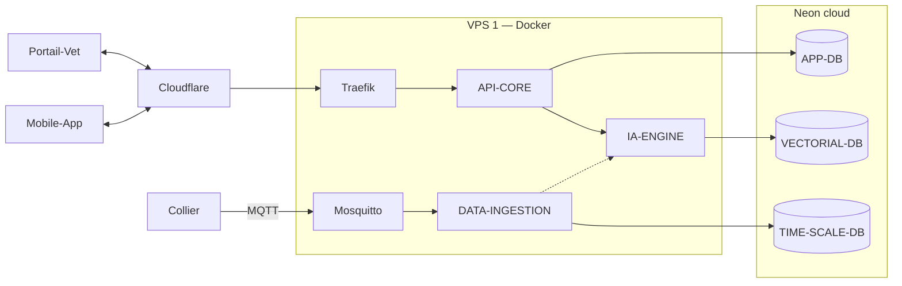
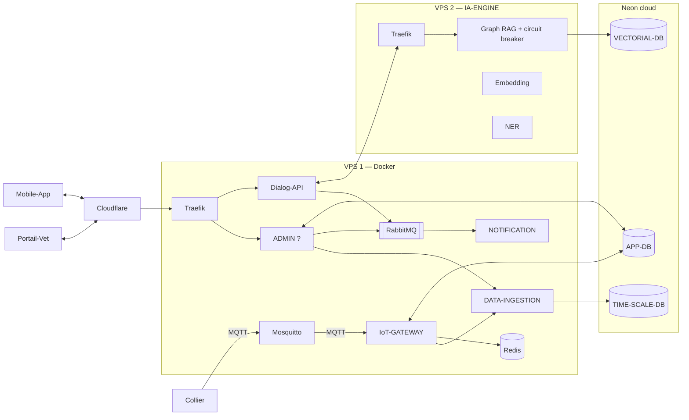

# Architecture macroservices

Source : Figma « architecture » (file key `Bft02JTu1bjMWeNpvYIyBt`, page 1), relevé le 2026-10-18. Les deux schémas sont marqués **« en travaux »** dans le Figma. Les `?` sont des valeurs absentes du Figma, pas des oublis de relevé.

Légende Figma : flèche simple = *write*, pointillés = *read*, double flèche = *read & write* (du demandeur vers le receveur).

## MVP

## Post-MVP

`ADMIN ?` : le cube central n'a pas d'étiquette visible ; un texte « ADMIN » blanc sur fond blanc traîne juste au-dessus. Rôle supposé = API-CORE (même icône, mêmes liens) — à confirmer.

## Services

| Service | Rôle | Stack | Port | Protocole | Équipe |
| --- | --- | --- | --- | --- | --- |
| API-CORE | Cerveau métier : API REST pour l'app et le portail véto ; utilisateurs, animaux, abonnements ; orchestre les notifications | NestJS / Node.js | 3000 | REST / HTTP | Back |
| IoT-GATEWAY *(post-MVP)* | Réception MQTT, auth applicative via Redis | ? | 3001 | MQTT + HTTP | ? |
| DATA-INGESTION | Consomme les événements publiés par l'IoT-Gateway ; normalise, déduplique, persiste dans TimescaleDB ; agrège les métriques journalières | ? | 3002 | AMQP (RabbitMQ) | ? |
| IA-ENGINE | Analyse comportementale + chat véto : score bien-être, anomalies, LLM + RAG. Post-MVP : Embedding, NER, Graph RAG + circuit breaker | Python / FastAPI | ? | REST / HTTP | IA |
| Dialog-API *(post-MVP)* | Aucune fiche | ? | ? | ? | ? |
| NOTIFICATION *(post-MVP)* | Aucune fiche | ? | ? | ? | ? |

## Clients et périphériques

| Élément | Description |
| --- | --- |
| Mobile App | App propriétaire : bien-être, GPS, alertes, chat IA. Stack ?, équipe Ibrahim · Adam |
| Portail-Vet | Hébergé sur Cloudflare Pages |
| Collier Pawrise | ESP32, firmware C/C++, GPS + accéléromètre + température. Envoie les *Pawrise Data Packets* en BLE vers l'app ou en LTE-M vers la plateforme |

## Infrastructure

| Élément | Rôle | Détails |
| --- | --- | --- |
| Cloudflare | DNS proxy, masque l'IP du VPS, anti-DDoS ; héberge le portail véto (Pages) | Plan Free |
| Traefik | Entrée HTTP/HTTPS du VPS, routage par sous-domaine ou path, TLS Let's Encrypt | v3 (Docker), port entrant ? |
| Mosquitto | Broker MQTT des colliers (sessions, QoS, topics, keep-alive, sécurité) ; évite de recoder MQTT dans le Gateway | — |
| RabbitMQ *(post-MVP)* | Tampon asynchrone « zéro perte » | AMQP 0-9-1, port ? |
| Redis *(post-MVP)* | Cache d'auth de l'IoT-Gateway | — |
| VPS 1 | Tous les services backend sauf IA-ENGINE | Ubuntu 24.04, 4 vCores, 8 Go RAM, 80 Go SSD, IP fixe, Docker Compose, hébergeur ? |
| VPS 2 | IA-ENGINE seul (Python + modèles ML ≈ consommation de tous les autres services) | — |

Choix « un seul VPS » : coût et simplicité d'exploitation ; scaling vertical d'abord.

## Bases de données (Neon, PostgreSQL 17)

| Base | Contenu | Accédée par |
| --- | --- | --- |
| APP-DB | Entités métier (utilisateurs, animaux, abonnements, profils véto). ORM Prisma | API-CORE (+ IoT-GATEWAY post-MVP) |
| TIME-SCALE-DB | Séries temporelles capteurs (TimescaleDB) | DATA-INGESTION (écriture), IA-ENGINE, API-CORE (lecture seule : mesures brutes, batterie, position, séries ; décision 2026-10-30, D10, à confirmer avec Yassine) |
| VECTORIAL-DB | Embeddings du corpus véto (pgvector, dimension 1536 — OpenAI) | IA-ENGINE |

## Interfaces à contractualiser

Base de travail pour le contrat d'interface : chaque ligne est une frontière entre deux équipes.

| # | Producteur → Consommateur | Transport | Phase |
| --- | --- | --- | --- |
| I1 | Mobile-App / Portail-Vet → API-CORE (via Cloudflare + Traefik) | REST / HTTPS | MVP |
| I2 | Collier → Mosquitto | MQTT (topics, QoS, format des Data Packets) | MVP |
| I3 | Collier → Mobile-App | BLE | MVP |
| I4 | Mosquitto → DATA-INGESTION (MVP) / → IoT-GATEWAY (post-MVP) | MQTT | MVP |
| I5 | API-CORE → IA-ENGINE | REST / HTTP (dont score bien-être et synthèse santé, D10) | MVP |
| I6 | IA-ENGINE ⇢ données de DATA-INGESTION (lecture, pointillés) | ? (TimescaleDB partagée ?) | MVP |
| I7 | IoT-GATEWAY → DATA-INGESTION | AMQP (RabbitMQ) selon les fiches ; flèche directe sur le schéma | Post-MVP |
| I8 | Dialog-API ↔ IA-ENGINE (via Traefik VPS 2) | ? | Post-MVP |
| I9 | API-CORE / Dialog-API → RabbitMQ → NOTIFICATION | AMQP | Post-MVP |

## Écarts à trancher

1. **Place de RabbitMQ.** Les fiches RabbitMQ et DATA-INGESTION, et `decisions.md`, le placent entre IoT-Gateway et Data-Ingestion uniquement. Le schéma post-MVP le place entre API-CORE/Dialog-API et NOTIFICATION, et relie IoT-Gateway → Data-Ingestion en direct.
2. **IoT-Gateway absent du MVP.** `overview.md` le compte parmi les 5 services ; le schéma MVP fait passer Mosquitto directement à DATA-INGESTION.
3. **File & Export** (`overview.md`) n'apparaît pas dans le Figma ; **Dialog-API**, **NOTIFICATION** et **ADMIN** n'apparaissent pas dans `overview.md`.
4. **Hébergement des bases** : cartes post-MVP sur « Supabase cloud », schéma et fiche Neon sur Neon ; `decisions.md` retient Neon.
5. **App-DB / Vet-DB** : `overview.md` et `bdd/` distinguent deux bases métier ; le Figma n'a qu'APP-DB.
6. **Accès DB de l'IoT-Gateway** (post-MVP, double flèche vers APP-DB) : non décrit dans sa fiche (Redis seulement).
7. Valeurs manquantes : port IA-ENGINE, stacks IoT-Gateway / Data-Ingestion / Mobile App, port RabbitMQ, port Traefik, hébergeur VPS.
